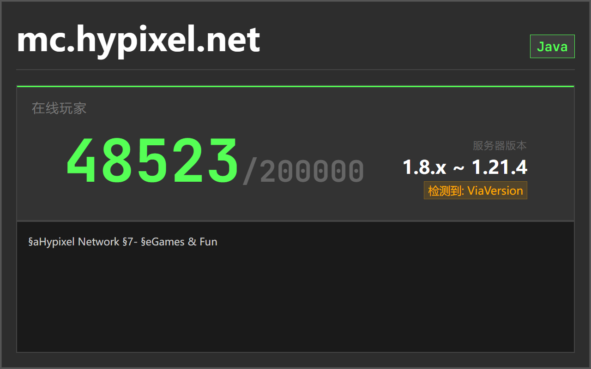
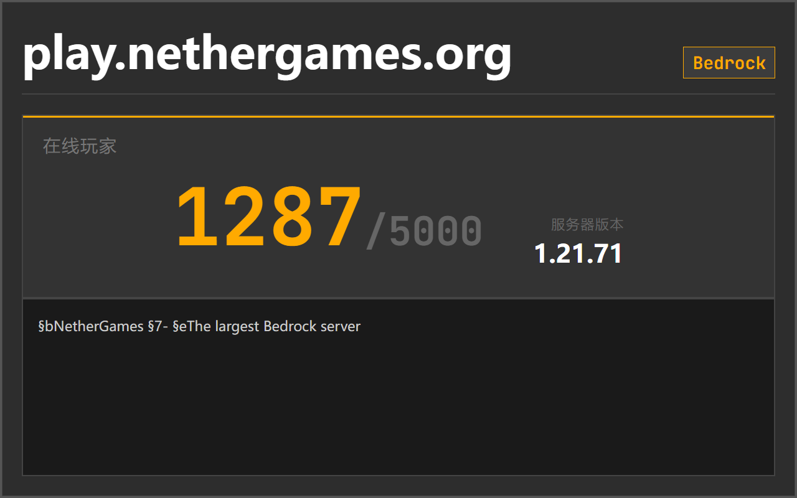
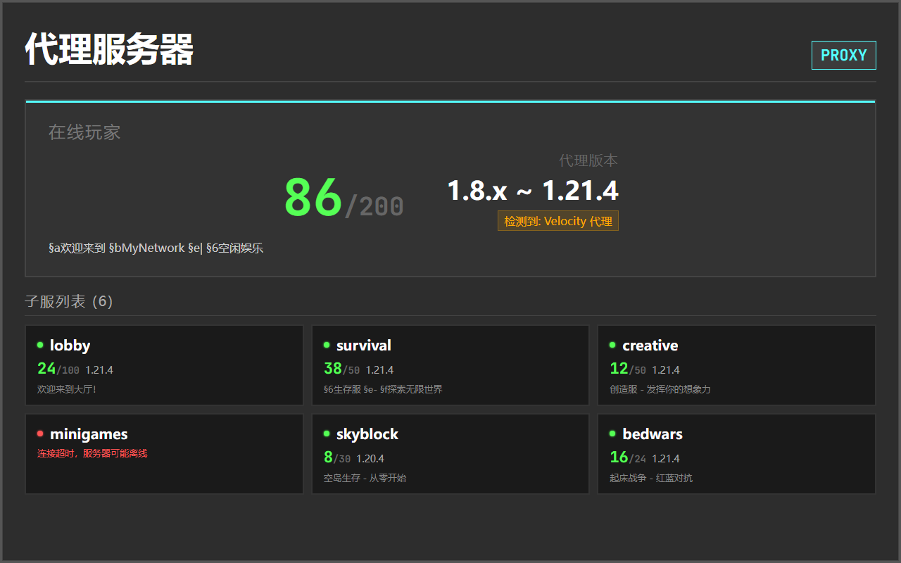

# AstrBot MOTD 查询插件 (`server-motd`)

一个用于查询 Minecraft 服务器状态的 AstrBot 卡片查询插件。支持 Java 版和基岩版服务器、ViaVersion/Velocity/BungeeCord 版本识别，并内置随机二次元壁纸背景与玩家头像网格渲染。

> **1.7.6 地址访问规则**：默认仅查询公网地址。内网服需由管理员在 AstrBot WebUI 的「允许查询的内网服务器 IP/网段」中添加精确 IP 或 CIDR。白名单对所有获准使用插件的会话生效；图标下载始终拒绝内网地址。





---

## 🌟 功能特性

- 🎮 **MOTD 查询**: 实时查询 Minecraft 服务器的 MOTD、在线玩家数、延迟、版本等信息。
- 🎨 **精美图片渲染**: 基于 HTML/CSS 生成状态卡片：单服/双服为 1280×720，三服为 1280×960，保留现有清晰背景与像素阴影风格。
- 🖼️ **随机壁纸背景**: 内置后台异步壁纸拉取与压缩缓存池，查询时毫秒级随机抽取背景，零耗时等待。
- 👤 **在线玩家头像**: 单服与多服的现行命令入口均准备最多 16 个槽位；样本超过 16 人时为前 15 人及剩余人数。单服可完整展示，多服保留现有卡片限高布局，超出可见区域的槽位可能被裁剪。人数取决于服务器公开的玩家样本（头像基于 Minotar / MC-Heads）。
- 🔀 **ViaVersion 智能兼容**: 自动识别 ViaVersion 多版本服务端，精准提取并显示客户端支持版本范围（如 `1.8 ~ 1.21.4`）。
- 🌐 **代理版本识别**: 可查询 Velocity/BungeeCord 对外开放的 Java 状态端口并识别版本范围。当前不提供 velostat HTTP API 集成或自动发现子服；已知子服地址可作为普通服务器分别查询。
- ⚡ **多默认服务器并发**: 支持配置最多三台默认服务器，使用异步 TCP/UDP，`/motd` 并发查询并自动合并为状态大图，查询可及时超时或取消。
- 💬 **人性化指令体验**: 无需强制加 `/`（直接发 `motd` 即可响应），支持 `motd set1~set3` 与 `motd remove` 动态配置。
- 🛡️ **双查询引擎**: 默认优先使用稳定高效的 `mcstatus.io` API，支持无缝降级直连查询。

---

## 💻 环境要求与依赖安装

### 1. 基础环境
- **Python**: `>= 3.10`（推荐 3.11 或 3.12）
- **AstrBot**: `>= 3.4.0`

### 2. Python 依赖自动补齐
本仓库根目录已包含标准 `requirements.txt`：
```text
aiohttp>=3.8.0
Pillow>=9.0.0
```

> **自动补齐**：当你在 AstrBot WebUI 插件管理中安装或从本仓库 Git 安装时，AstrBot 会**自动检测并安装**上述 Python 依赖，无需手动操作。

若处于特殊离线环境或需要手动补齐依赖，可在 AstrBot 运行环境中执行：
```bash
pip install -r requirements.txt
```

### 3. 图片渲染支持（Playwright）
卡片渲染依赖 AstrBot 内置的 `html_render` 服务。若使用本地渲染器且首次运行报错缺少浏览器内核，请确保安装了 Chromium：
```bash
# 进入 AstrBot 的 Python 环境后运行
playwright install chromium
playwright install-deps  # Linux 环境补齐系统依赖库
```
*(注：若使用 AstrBot 官方 Docker 镜像或配置了独立的网络渲染端点，则无需额外配置)*。

---

## 📦 安装方法

### 方法一：从 AstrBot 插件市场安装（推荐）
在 AstrBot 的 WebUI 插件市场中搜索 `server-motd` 或 `Minecraft 服务器 motd 查询`，点击安装。

### 方法二：从 Git 仓库或压缩包安装
在 AstrBot 根目录的 `data/plugins/` 下克隆本仓库：
```bash
cd data/plugins
git clone https://github.com/lsy112yhu/server-motd.git astrbot_plugin_minecraft_motd
```
或直接下载本仓库的 Release / ZIP 解压至该目录。安装后**重启 AstrBot** 即可生效。

---

## 🎨 随机壁纸背景配置

插件内置了基于 `t.alcy.cc` 的壁纸异步预热引擎，可在配置面板自定义背景风格：

| 配置项 | 默认值 | 可选值 / 说明 |
|--------|--------|--------------|
| `enable_random_wallpaper` | `true` | 是否启用随机卡片壁纸背景（关闭则使用经典半透明纯色底） |
| `wallpaper_category` | `moe` | 壁纸分类：<br>• `moe`：二次元萌系插画（默认）<br>• `pc`：通用高清横屏壁纸<br>• `fj`：自然风景<br>• `bd`：白底简约<br>• `ys`：原神主题 |
| `wallpaper_cache_count` | `100` | 本地缓存池容量（张数，10~200）。插件在后台静默预取，不占用查询响应时间 |
| `wallpaper_prefetch_concurrency`| `3` | 后台并发下载数（1~6） |

---

## ⚙️ 完整配置项说明

可在 AstrBot WebUI 插件配置中可视化调整，或直接修改 `data/config/astrbot_plugin_minecraft_motd_config.json`：

| 配置项 | 类型 | 默认值 | 说明 |
|--------|------|--------|------|
| `default_servers` | list | `[]` | 默认并发查询的服务器列表（最多 3 个），不带参数时触发 |
| `enable_all_sessions` | bool | `true` | 是否对所有群聊和私聊生效 |
| `enabled_sessions` | list | `[]` | 白名单会话列表（当关闭全会话生效时生效） |
| `admin_only_config` | bool | `true` | 仅 AstrBot 管理员可使用 `set`/`remove` 指令修改配置 |
| `query_timeout` | int | `5` | 服务器查询超时时间（秒） |
| `use_api` | bool | `true` | 优先通过 `mcstatus.io` API 查询，失败时自动降级直连 |
| `private_server_allowlist` | list | `[]` | 允许查询的非公网 IP/CIDR；在连接前验证全部 DNS 结果并固定实际连接 IP，不接受域名 |
| `enable_player_avatars` | bool | `true` | 是否显示在线玩家头像网格 |
| `render_timeout` | int | `20` | HTML 图片渲染硬超时（秒） |

---

## 📖 指令列表

### 玩家常用指令
| 指令 | 说明 | 示例 |
|------|------|------|
| `/motd` 或 `motd` | 并发查询默认服务器列表 | `motd` |
| `motd <地址>` | 查询指定服务器（默认 25565） | `motd mc.hypixel.net` |
| `motd <地址:端口>` | 查询指定服务器与端口 | `motd play.example.com:25565` |
| `/在线` 或 `在线` | 查询别名 | `在线` |
| `motd-bedrock` | 查询默认基岩版服务器 | `motd-bedrock` |
| `motd-bedrock <地址:端口>` | 查询指定基岩版服务器 | `motd-bedrock mc.example.com:19132` |

### 管理员配置指令
| 指令 | 说明 | 示例 |
|------|------|------|
| `/motd set1 <地址>` | 设置第 1 台默认服务器（会先验证连通性） | `/motd set1 server1.example.com` |
| `/motd set2 <地址>` | 设置第 2 台默认服务器 | `/motd set2 server2.example.com` |
| `/motd set3 <地址>` | 设置第 3 台默认服务器 | `/motd set3 server3.example.com` |
| `/motd remove <1\|2\|3>` | 清除指定槽位的默认服务器（配置自动前移） | `/motd remove 1` 或 `/motd del set2` |
| `/motd get` | 查看当前已保存的默认服务器与配置 | `/motd get` |

---

## 🛠️ 故障排查

1. **发送 `motd` 无响应**：
   - 检查 AstrBot 控制台日志，确认看到 `[MOTD] 插件已加载 v1.7.6`。
   - 确认发送者或群聊是否符合会话规则。
2. **卡片图片无法渲染（提示超时或报错）**：
   - 确认宿主环境已安装 Playwright 依赖（`playwright install chromium`）。
   - 可在插件配置中将 `render_timeout` 适当调大（例如 25 秒）。
3. **玩家头像显示为默认灰色问号**：
   - 正常现象，当服务器为离线模式（盗版服）或第三方皮肤站、玩家 UUID 无法在官方 Mojang/Minotar 解析时，插件会自动显示本地兜底占位图，不影响整体排版。

4. **内网服提示「此地址不允许查询」**：
   - 在 AstrBot WebUI 插件配置中将该服的精确 IP 加入 `private_server_allowlist`，例如 `192.168.1.10/32`；域名的所有解析结果都必须符合访问规则。
   - 只开放需要查询的 IP/网段，避免填写 `0.0.0.0/0` 或 `::/0`。组播和未指定地址始终拒绝。
   - 服务器图标仅接受经过大小和图片格式校验的 PNG/JPEG/WebP；远程图标先在插件端下载，禁止重定向和内网访问，失败时显示占位符。

## 回归验证

```bash
python -m unittest discover -s tests -v
```

测试使用本机真实 TCP/UDP 状态端点验证并发、超时、取消和 RakNet 报文，并覆盖地址限制、协议映射及模板上下文。测试用的 AstrBot 接口替身仅隔离框架依赖，不能替代实际 AstrBot/QQ 出图验收。

---

## 📄 开源许可证

本项目基于 [MIT License](LICENSE) 开源。
